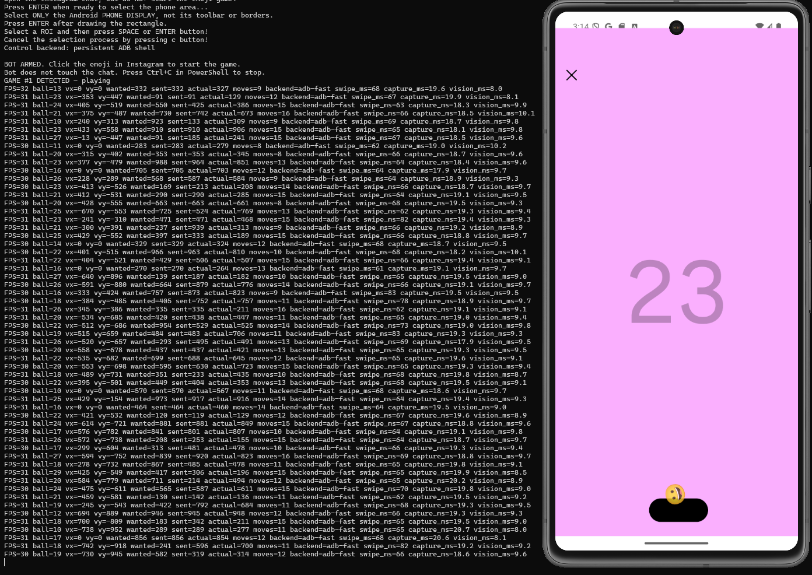

# Instagram Emoji Pong Bot 

An experimental Python bot for Instagram's hidden **emoji Pong** game, running in an **Android emulator on Windows**.

It captures the visible emulator window with `mss`, uses OpenCV to locate the bouncing emoji and predict its landing position, and moves the paddle using Android Debug Bridge (**ADB**). You start the first game manually; optional auto-replay can start subsequent games.




Python file is unchanged from the tested script. In development, one run reached **50 hits**; scores vary considerably by device and emulator performance and are **not guaranteed**. The results might also vary depending on the accuracy of your screenshot, which is a limitation.

## Requirements

- Windows 10/11 with Python 3.10+ and `py` launcher.
- Android Studio / Android Emulator with a virtual device that can run Instagram.
- Android SDK **Platform-Tools** (including `adb.exe`).
- Instagram installed and signed in **inside the emulator**.
- The emulator display must be **visible and unobstructed** on your primary Windows monitor.

The script expects ADB at `%LOCALAPPDATA%\Android\Sdk\platform-tools\adb.exe` and defaults to device `emulator-5554`. If your SDK or device is different, see [Configuration](#configuration).

## Quick start

**1. Get the project**

Download and extract the repository, or clone it:

```powershell
git clone https://github.com/YOUR_USERNAME/instagram-emoji-pong-bot.git
cd instagram-emoji-pong-bot
```

Replace `YOUR_USERNAME` with the repository owner's GitHub username once the repo is published.

**2. Install Python dependencies**

```powershell
py -m pip install -r requirements.txt
```

**3. Start the Android emulator**

Open your virtual Android phone, install Instagram, and navigate to a DM containing an emoji that launches the game. **Do not start the game yet.**

Confirm ADB sees the device:

```powershell
& "$env:LOCALAPPDATA\Android\Sdk\platform-tools\adb.exe" devices
```

You should see a connected device such as `emulator-5554    device`.

**4. Run the bot**

These are the settings used in the later development tests:

```powershell
py bot.py --controller adb-fast --vision-width 360 --swipe-ms 35 --lead-ms 0 --preposition-up
```

To enable up to 15 games with automatic replay:

```powershell
py bot.py --controller adb-fast --vision-width 360 --swipe-ms 35 --lead-ms 0 --preposition-up --auto-replay 15
```

**5. Calibrate and play**

1. With the Instagram chat visible, press **Enter** in PowerShell when prompted.
2. A *frozen screenshot window* opens. Draw a rectangle around the **entire Android display**, excluding the emulator toolbar and borders.
3. Press **Enter** to confirm the selection. Do **not** select the emoji itself.
4. When you see `BOT ARMED`, return to the real emulator window and **tap the emoji manually** to start the game.
5. The bot detects the active game and moves the paddle. Use **Ctrl+C** in PowerShell to stop.

Do not move or resize the actual emulator after calibration.

## Configuration

| Flag | Meaning |
| --- | --- |
| `--device emulator-5554` | ADB serial from `adb devices`. |
| `--controller adb-fast` | Persistent ADB shell. Other options: `adb`, `console`. The experimental `console` backend may not move the paddle on all emulators. |
| `--vision-width 360` | Width used for ball detection; smaller can be faster but less accurate. |
| `--swipe-ms 35` | Requested swipe duration. *Actual* ADB command latency can be substantially higher. |
| `--lead-ms 0` | Extra horizontal prediction lead in milliseconds. |
| `--preposition-up` | Start predicting landing position during upward travel. |
| `--top-wall 0.155` | Estimated top bounce boundary, relative to display height. |
| `--auto-replay 15` | Play up to 15 games, automatically tapping **Play again** between games (`0` disables auto-replay). |
| `--output-dir PATH` | Choose where result and diagnostic images are saved. |

Run `py bot.py --help` for the complete argument list.

If the SDK is not under your usual Windows user profile, update the `ADB` constant near the top of `bot.py`.

## How it works

```text
Windows screenshot of emulator
           |
           v
  Crop selected phone display
           |
           v
  Background / gradient estimate
           |
           v
  Emoji detection + motion tracking
           |
           v
  Predict paddle intercept
           |
           v
  ADB touchscreen swipe
           |
           +----> repeat while the game is active
```

**Auto-replay:** The bot first looks for the large white **Play again** button. If the button isn't visible in the calibrated crop, it can recognize the large white `NN Hits` heading on the results screen and tap the expected button position in Android coordinates. It verifies that results remain visible before retrying a tap.

## Troubleshooting

**The bot doesn't detect the game:** Make sure you selected the *actual phone display* rather than the whole desktop or the emulator toolbar. Keep the emulator visible after calibration.

**The paddle doesn't move:** Check `adb devices` and try `--controller adb`. The experimental `console` controller was not reliable in our tests.

**It detects the wrong thing or loses the emoji:** Avoid covering the emulator; adjust the crop and test `--vision-width 360`. The gradient-aware detector is still heuristic.

**Poor scores despite good FPS:** Standard Android `input swipe` calls can take approximately 80–140 ms end-to-end on some setups. The bot cannot overcome that delay just by increasing capture FPS.

**Auto-replay doesn't work:** Use `--auto-replay N`, include the full Android display in your selection, and look for messages such as `Game 1 finished`, `Auto replay: detected ...`, or `Replay retry ...`.

**Outputs:** Screenshots are written to a timestamped `emoji_runs/` directory. These are excluded from Git by default because they can contain account information, chats, or avatars.

## Limitations and privacy

- Tested as a **Windows + Android Emulator** workflow, not direct iPhone automation.
- **No password or Instagram API token** is needed in the Python code. Sign into Instagram inside the emulator itself.
- Score outcomes vary; this is an experimental computer-vision project, not a guaranteed high-score tool.
- Saved screenshots may contain private account/chat content. **Do not commit or upload your debugging images.**

## Project files

```text
bot.py                    Main bot (v3.5 + replay fix)
requirements.txt          Python dependencies
README.md                 Setup and operation
CHANGELOG.md              Development history
LICENSE                   MIT license
.gitignore                Excludes screenshots, logs, caches, secrets
.github/workflows/check.yml  Python syntax check
```

## License

MIT. See [LICENSE](LICENSE).
